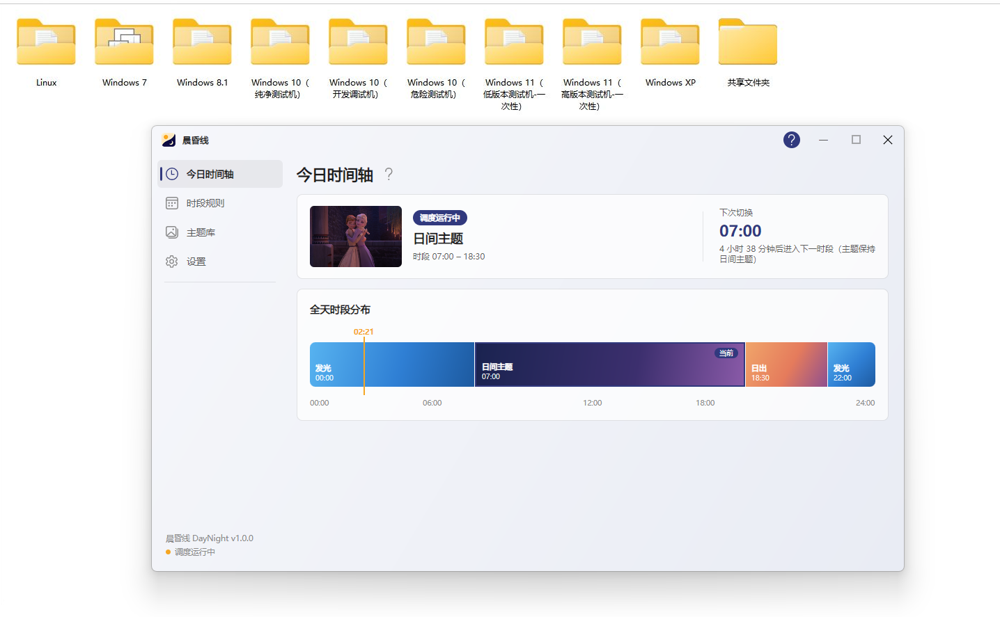
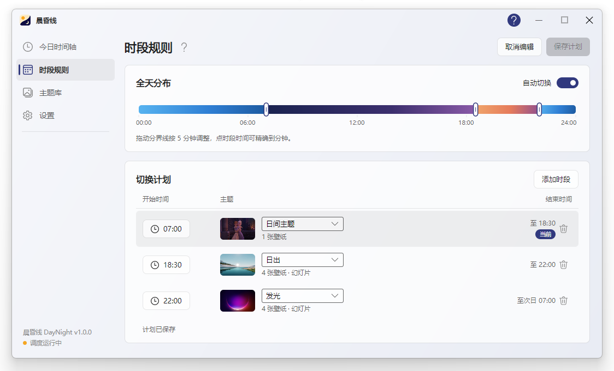
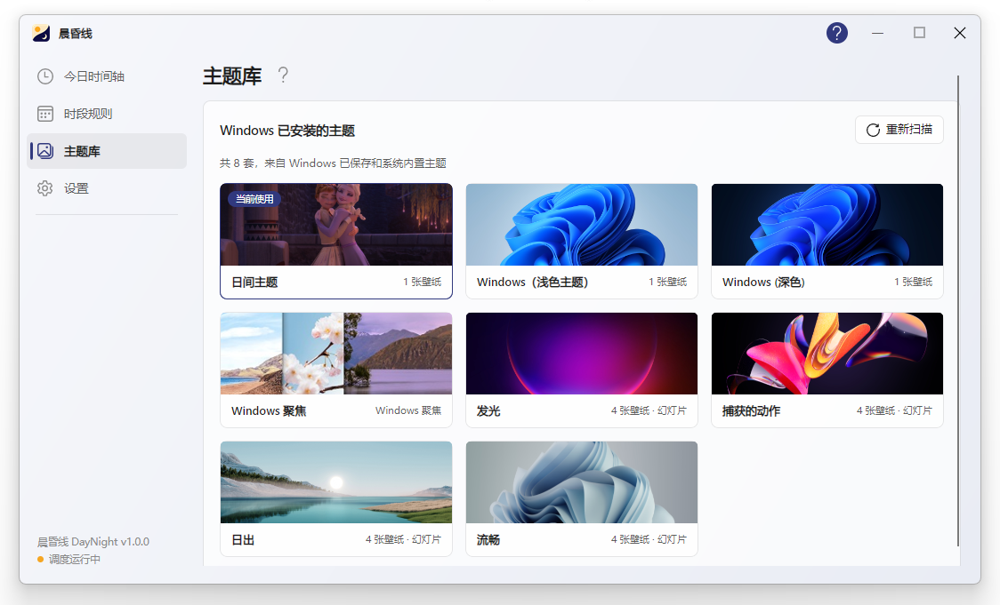
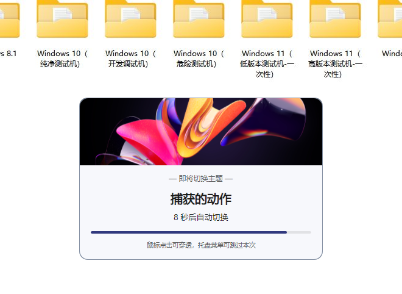
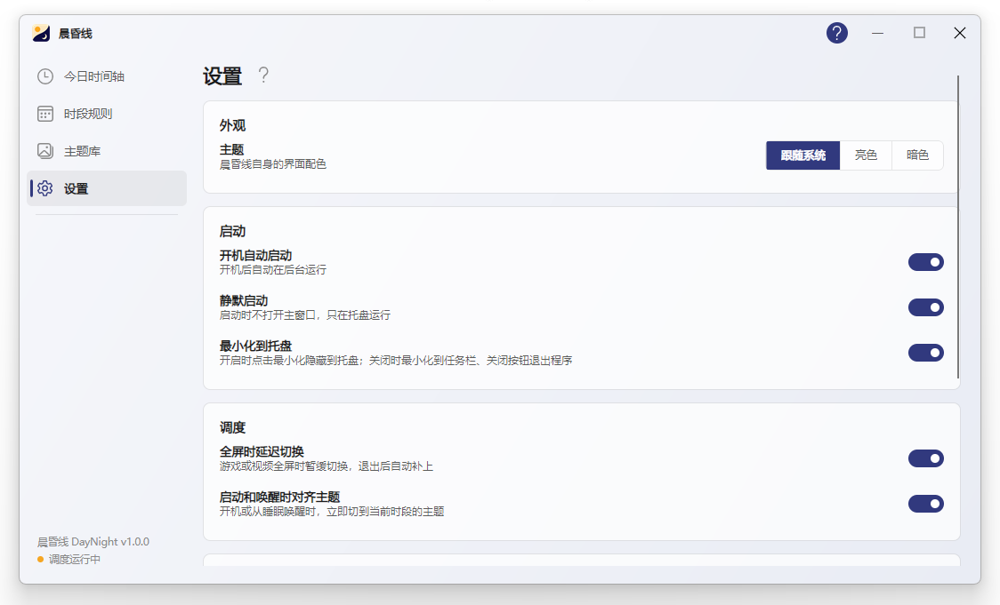

# 晨昏线 · DayNight


晨昏线是一款按每日计划自动切换 Windows 整套主题的桌面工具。例如 07:00 应用日间主题，22:00 切换到「发光」，并延续到次日 07:00。每个时段绑定一套已安装的 Windows 主题，壁纸、明暗模式、强调色与声音方案随主题一并切换。

Windows 11 内建的定时切换仅覆盖系统深浅色；整套主题（壁纸 + 强调色 + 配色 + 声音方案）的定时轮换尚无官方支持，晨昏线用于补足这一需求。



## 功能特性

- **整套主题切换**　通过 Windows 原生主题管理器应用完整 `.theme` 主题包，壁纸、系统与应用明暗、强调色、声音方案一并生效，并以真实应用结果核对成败。
- **全天覆盖计划**　时段首尾相接铺满 00:00–24:00，午夜后延续当日末段主题，无需为深夜单独设置时段。
- **可视化计划编辑**　拖动分布条上的切换点可按 5 分钟吸附调整，双圈时钟可精确选择到分钟；修改先进入草稿，保存后统一生效。
- **主题库管理**　扫描系统与当前用户已安装的主题，展示壁纸预览并标记当前主题，支持重新扫描与手动应用；手动应用的主题保持到当前时段结束，之后按计划切换。
- **切换预告（OSD）**　切换前在屏幕中央显示目标主题与倒计时（默认提前 5 秒，可调 3–10 秒）；提示卡半透明、置顶且鼠标点击穿透，不打断当前操作。
- **全屏延迟**　检测到独占全屏（游戏、视频、演示）时暂缓切换且不弹预告，退出全屏后自动补切。
- **错过对齐**　启动、开机与睡眠唤醒时立即对齐当前时段主题，不累积误差。
- **手动干预**　支持「保持到明天」跳过当日剩余切换、托盘「跳过本次切换」与「复位自动调度」；程序运行期间在主题库或 Windows 个性化设置中更换主题，同样保持到下一个切换点；手动状态持久化，重启后保留。
- **后台运行**　托盘常驻、单实例互斥；支持最小化到托盘、开机自动启动与静默启动（仅托盘，不弹主窗口）。

## 界面预览

<details>
<summary>查看时段编辑和主题库截图</summary>

**时段规则**



**主题库**



</details>

<details>
<summary>查看切换预告和设置截图</summary>

**切换预告**



**设置**



</details>

## 安装

### 系统要求

| 项目 | 要求 |
| --- | --- |
| 操作系统 | Windows 11（已实机验证）；Windows 10 兼容性尚待验证 |
| 架构 | x64 |
| 运行时 | 无需额外安装，自包含发布已内置 .NET 运行时 |
| 权限 | 当前用户即可，无需管理员 |

### 安装步骤

运行安装程序 `DayNight-Setup-1.1.3-win-x64.exe`，安装到当前 Windows 账户。使用文件夹版时，将整个发布文件夹复制到固定位置，双击其中的 `DayNight.exe`。

卸载前从托盘菜单选择 **退出**，再从 Windows 的 **设置 → 应用 → 已安装的应用** 卸载晨昏线。卸载程序询问是否删除计划和设置，默认保留。选择删除会清理当前账户的配置、配置备份和临时文件；运行日志保留。静默卸载也会保留配置。

## 快速上手

1. 打开 **时段规则 → 编辑计划**，为每个时段选择开始时间和主题。每段的结束时间由下一段的起点决定，最后一段自动跨越午夜。
2. 点击 **保存计划** 并开启 **自动切换**。
3. 打开 **今日时间轴**，核对 Windows 实际使用的主题和下一次切换时间。

开启 **设置 → 最小化到托盘** 后，点最小化按钮即可在后台继续调度。点关闭按钮或按 Alt+F4 时，可以选择 **最小化到托盘**、**退出程序** 或 **取消**。需要随 Windows 登录启动时，可同时打开 **开机自动启动** 和 **静默启动**。

## 工作原理

1. 主题库扫描 `%LOCALAPPDATA%\Microsoft\Windows\Themes` 与 `C:\Windows\Resources\Themes` 下的 `.theme` 文件，解析壁纸预览，并读取注册表标记当前主题。
2. 调度引擎按秒检查切换点；到达预告时间后弹出 OSD，倒计时结束即调用 Windows 原生主题管理器应用该时段绑定的主题。
3. 切换完成后发送托盘气泡通知并写入日志；计划、偏好与手动状态持久化到 `config.json`。

## 数据与日志

| 内容 | 路径 |
| --- | --- |
| 配置（时段、偏好、手动状态） | `%APPDATA%\DayNight\config.json` |
| 运行日志（按日期滚动） | `%APPDATA%\DayNight\logs\` |

备份时退出晨昏线，复制 `config.json` 即可；恢复时放回原路径。

## 常见问题

**Windows 里刚保存的主题，怎样加进计划？**
打开 **主题库 → 重新扫描**，再到 **时段规则 → 编辑计划** 选择该主题。

**在主题库或 Windows 设置里换了主题，会被切回计划吗？**
晨昏线运行期间手动更换的主题会保持到当前时段结束，界面显示 **手动保持中** 和恢复时刻，到下一个切换点按计划切换；点 **复位自动调度** 可提前恢复。晨昏线未运行时更换的主题，下次启动会对齐回当前时段的计划主题。

**到了设定时间，桌面仍然是原来的主题，怎么排查？**
先在 **今日时间轴** 核对当前时段，并确认 **自动切换** 已开启。如果之前手动保持过主题，可在 **时段规则** 点击 **复位自动调度**。如果开启了全屏延迟，先退出全屏。仍有问题时，在 **设置 → 打开日志目录** 查看对应时间的切换记录。

**提示主题应用失败，怎么进一步定位？**
失败分为两类：Windows 主题管理器应用出错，或应用后核对发现当前主题、明暗模式、强调色与预期不符。具体原因记录在 `%APPDATA%\DayNight\logs\` 的当日日志中，可结合日志中的时间点排查。

## 从源码构建

项目使用 C# / .NET 8 / Avalonia，测试基于 xUnit。准备一台安装了 [.NET 8 SDK](https://dotnet.microsoft.com/download/dotnet/8.0) 的 Windows 电脑，在仓库根目录运行以下 PowerShell 命令。

```powershell
# 启动桌面应用
dotnet run --project .\DayNight\DayNight.csproj

# 运行测试
dotnet test .\tests\DayNight.Tests\DayNight.Tests.csproj -c Release

# 生成 Windows x64 自包含版本
dotnet publish .\DayNight\DayNight.csproj -c Release -p:PublishProfile=FolderProfile
```

Visual Studio 中选择 `FolderProfile` 发布，或执行上面的发布命令。两者均输出到 `DayNight\bin\Publish\`。制作安装包时，用 Inno Setup 6.4+ 编译 [daynight.iss](Setup/daynight.iss)，在 `Setup/Output/` 中得到 `DayNight-Setup-<版本>-win-x64.exe`。安装包从已发布的程序读取版本和公司信息，安装界面为简体中文（语言文件随仓库分发，声明见 [licenses](licenses/)）。

## 项目结构

```
晨昏线-Windows定时切换主题/
├─ DayNight/              主程序与项目资料（Avalonia 单项目，MVVM 分层）
│  ├─ Models/             数据模型：时段、计划、设置、手动状态
│  ├─ Services/           主题目录、主题应用、调度引擎与系统集成
│  ├─ ViewModels/         主窗口与四个导航页的视图模型
│  ├─ Views/              主窗口、四个页面与切换预告窗
│  ├─ Assets/             应用图标与资源（构建时嵌入应用）
│  ├─ design/             设计原稿：Logo 原图与 Fluent 图标 SVG
│  └─ docs/               开发文档：需求、设计、图标说明与界面原型
├─ tests/DayNight.Tests/  xUnit 测试：调度、计划编辑、主题目录与应用
├─ readme-assets/         README 截图
├─ scripts/               图标生成脚本
└─ licenses/              第三方素材许可声明
```

调度和 Windows 系统调用集中在 `Services` 层，ViewModel 负责界面绑定与转发。[需求文档](DayNight/docs/需求文档.md)与[设计文档](DayNight/docs/设计文档.md)位于 `DayNight/docs/`。

## 作者与许可

**作者** Jhonie King · **公司** AutoSquare

晨昏线的原创代码和文档采用 [MIT 许可证](LICENSE)发布。随源码分发的第三方图标及代码声明见 [licenses](licenses/)；截图中的 Windows 界面、主题壁纸等第三方素材归各自权利人所有。
